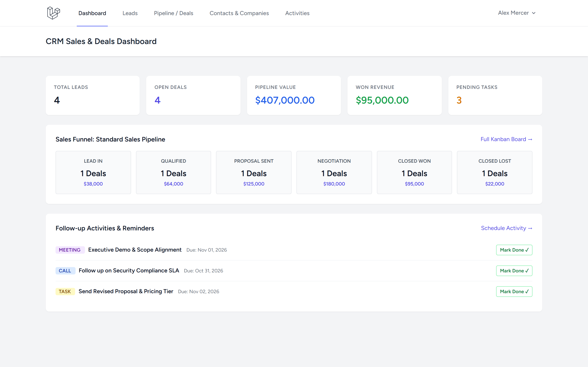
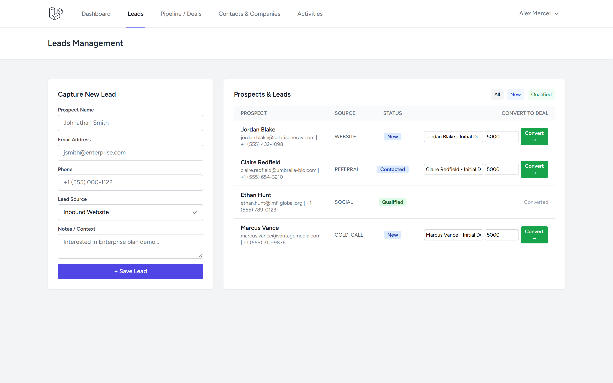
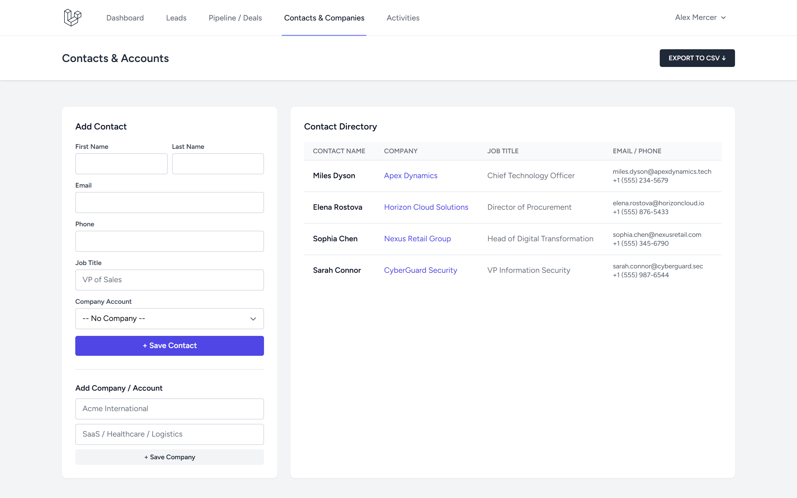
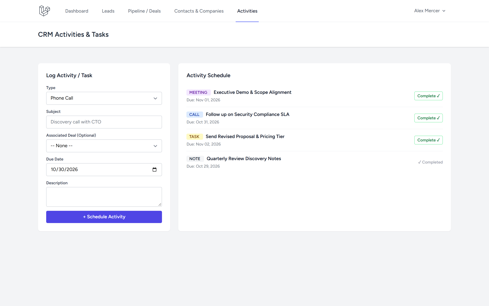

# CRM (Customer Relationship Management) — Laravel

Full-featured Customer Relationship Management application built with Laravel 11/13, Blade, and Tailwind CSS, featuring sales pipelines, lead conversions, contacts directory, activity tracking, and CSV exports.

[]()
[]()

---

## 1. Project Overview

**CRM Laravel** provides sales teams with structured relationship and pipeline tracking:
- **Lead Capture & Conversion**: Inbound & outbound lead management with source attribution, notes, and 1-click conversion into qualified deals and contacts.
- **Sales Pipelines & Stages**: Visual deal board across custom pipeline stages (`Lead In`, `Qualified`, `Proposal Sent`, `Negotiation`, `Closed Won`, `Closed Lost`).
- **Contacts & Accounts**: Organization and person directory with ownership isolation and streaming CSV export.
- **Activity & Task Management**: Scheduling and completion of calls, meetings, follow-up tasks, and deal-linked notes.
- **Data Security**: Strict per-user data scoping preventing unauthorized access across accounts.

---

## Screenshots

| Tampilan | Preview |
|---|---|
| **Sales Pipeline & Deals Dashboard**<br>Ringkasan metrik KPI penjualan (Total Leads, Open Deals, Pipeline Value, Won Revenue, Pending Tasks), sales funnel tahapan kesepakatan, dan agenda tindak lanjut |  |
| **Manajemen Prospek & Kualifikasi Leads**<br>Formulir intake prospek baru, tag sumber akuisisi, status prospek, serta konversi instan satu klik menjadi deals dan kontak |  |
| **Direktori Kontak & Akun Perusahaan**<br>Katalog kontak profesional terintegrasi dengan profil akun perusahaan, jabatan, informasi telepon/email, serta ekspor data CSV |  |
| **Agenda Aktivitas & Penjadwalan Tugas**<br>Pusat penjadwalan meeting, log panggilan telepon, tugas follow-up, catatan prospek, dan checklist penyelesaian aktivitas |  |

---

## 2. Technology Stack

- **Framework**: Laravel 11/13, Eloquent ORM
- **Auth**: Laravel Breeze
- **Database**: SQLite (default local & test) / PostgreSQL compatible
- **Frontend**: Blade + Tailwind CSS + Vite
- **Testing**: PHPUnit / Pest (32 automated tests, 86 assertions)

---

## 3. Quickstart

```bash
# Clone repository
git clone https://github.com/0xyz-exe/crm-laravel.git
cd crm-laravel

# Setup environment & dependencies
cp .env.example .env
composer install
php artisan key:generate

# Run migrations & seeders
touch database/database.sqlite
php artisan migrate

# Build frontend assets
npm install
npm run build

# Start dev server
php artisan serve
```

---

## 4. Verification

```bash
# Run test suite
php artisan test

# Validate Composer
composer validate

# Audit production npm packages
npm audit --omit=dev
```

---

## 5. License

MIT License. Developed as part of the Laravel Projects Factory.
